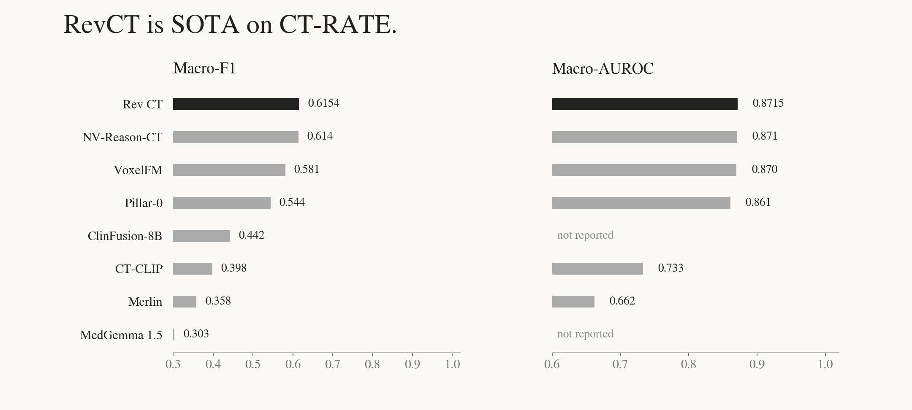
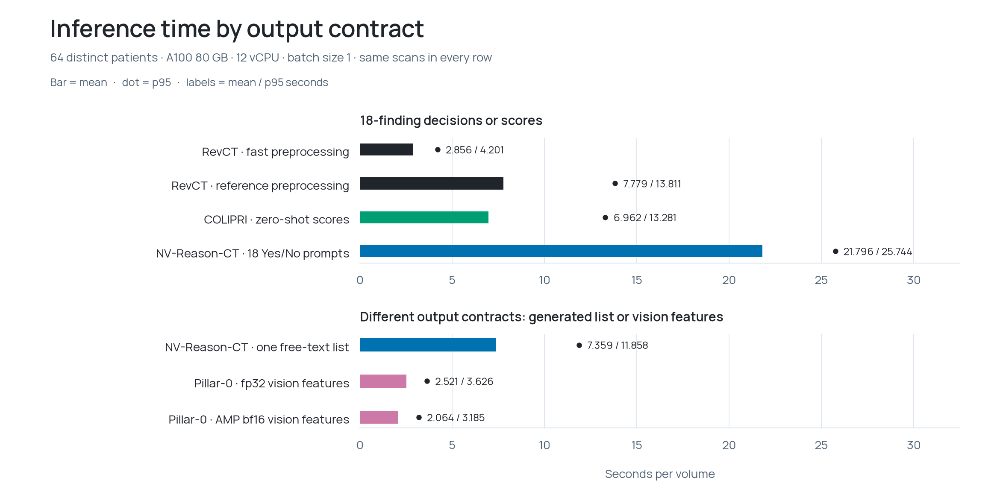

# RevCT

[](https://huggingface.co/hcltech-robotics/rev-ct)
[](docs/model-card.md)
[](docs/inference.md)
[](reports/benchmark.md)
[](https://github.com/hcltech-robotics/rev-ct/releases/tag/v0.3.2)
[](https://huggingface.co/spaces/chrisvoncsefalvay/rev-ct-demo)
[](https://doi.org/10.57967/hf/10861)

A typed decision model for computed tomography (CT).

RevCT identifies 18 diagnostic findings from chest CT scans, and returns
calibrated scores as typed decisions.

On CT-RATE's corrected 3,002-volume validation cohort, Rev achieves a **state-of-the-art 0.6154
macro-F1** and **0.8715 macro-AUROC**, ahead of NV-Reason-CT's reported
0.614, with AUROC at parity. The complete model has approximately **147M parameters** in a **589 MB**
checkpoint and inferences up to **8x faster**. 

## Interactive demo

[Try RevCT](https://huggingface.co/spaces/chrisvoncsefalvay/rev-ct-demo) with an example chest CT or a de-identified NIfTI volume. Browse axial, coronal and sagittal slices, inspect all 18 typed decisions and download the calibrated decision record. See [demo/README.md](demo/README.md) to run it locally.

## Install

```bash
gh repo clone hcltech-robotics/rev-ct
cd rev-ct
git checkout v0.3.2
python -m pip install '.[inference]'
hf auth login
```

Use Python 3.11+ with a PyTorch installation appropriate to your GPU.
The supported inference stack pins Transformers 5.6.2 and COLIPRI 0.1.3.
Hugging Face contains weights and loading metadata. This repository contains
the inference package, CLI, documentation, tests and benchmark scripts.

## Inference with Transformers

```python
import rev_ct  # registers decision-model with Transformers
import torch
from transformers import AutoModel, AutoProcessor

repo = "hcltech-robotics/rev-ct"
torch.backends.cuda.matmul.allow_tf32 = False
torch.backends.cudnn.allow_tf32 = False
model = AutoModel.from_pretrained(repo).eval().to("cuda")
processor = AutoProcessor.from_pretrained(repo, preprocessing="fast")
inputs = processor(images3d=["chest.nii.gz"], return_tensors="pt")

with torch.inference_mode():
    result = model(**inputs, volume_names=["chest.nii.gz"])

print(result.records[0])
```

Inputs are HU-valued NIfTI volumes with physical geometry. The processor
resamples to 2 mm and produces a centred 192³ input. DICOM needs prior
conversion. Reference preprocessing is the default. The explicit fast path
has pixel-identical outputs on all 64 tested scans and falls back for
unsupported geometry.

Import `rev_ct` before calling the Auto classes. No remote Python code or
`trust_remote_code` flag is required. Keep the model in fp32 and preserve the
mixed head tensor dtypes. There is no second encoder-weight download.
Save both model and processor with `save_pretrained()` for offline use with the installed package.

## Command line

```bash
rev-ct predict chest.nii.gz --output decisions.jsonl
rev-ct predict scan1.nii.gz scan2.nii.gz --preprocessing fast --workers 4 --output decisions.jsonl
rev-ct features cached.npz --output decisions.jsonl
```

Each `rev-1.0` record contains 18 finding decisions with a calibrated score
and decision confidence, a top-finding summary, mean-score burden and positive
finding count. Decisions use the training-selected bias, separately from score
calibration. The package also supports [Clef-shaped typed requests](docs/inference.md#typed-requests).

## Performance





Accuracy baselines reproduce NVIDIA's published table. Timings use the same
64 distinct patients on HF Jobs A100 80 GB machines with 12 allocated vCPU.
They include preprocessing and output conversion and exclude downloads and
model loading. NV single-list and Pillar feature rows perform different output
tasks. Exact values, protocols and pinned sources are in the
[model card](docs/model-card.md) and [benchmark report](reports/benchmark.md).

## Reproducibility

```bash
python -m pip install '.[test]' ruff build matplotlib
pytest -q
ruff check src tests scripts benchmarks
python -m build
python scripts/plot_comparisons.py
```

## Terms and limitations

RevCT is a research model and has not been clinically validated. Its fixed
vocabulary cannot establish a complete normal examination. It is not intended
for clinical purposes and shall not be relied upon for diagnosis or treatment
of any disease. Typed decision models' calibration is sensitive to
out-of-distribution errors and its validity should be verified when applying
it to different subpopulations or acquisition mechanics. Details are in the
[model card](docs/model-card.md).

Rev code and learned heads are **Apache-2.0**. The bundled COLIPRI encoder
retains its **MIT** licence in [COLIPRI_LICENSE](COLIPRI_LICENSE).
CT-RATE has separate gated dataset terms. See [NOTICE](NOTICE),
[LICENSE](LICENSE) and the [model card](docs/model-card.md).

Rev was developed at the HCLTech Robotics Intelligence CoE.

## Citation

If you use RevCT in your work, cite the software release and report the version
and checkpoint revision used. A machine-readable reference is available in
[CITATION.cff](CITATION.cff).

von Csefalvay, C., & Foldi, T. (2026). *RevCT: A typed decision model for computed
tomography (CT).* (Version 0.3.2) [Software]. HCLTech Robotics Intelligence CoE.
https://doi.org/10.57967/hf/10861

```bibtex
@software{voncsefalvay2026revct,
  author  = {von Csefalvay, Chris and Foldi, Tamas},
  title   = {RevCT: A typed decision model for computed tomography (CT)},
  year    = {2026},
  version = {0.3.2},
  doi     = {10.57967/hf/10861},
  url     = {https://github.com/hcltech-robotics/rev-ct}
}
```
