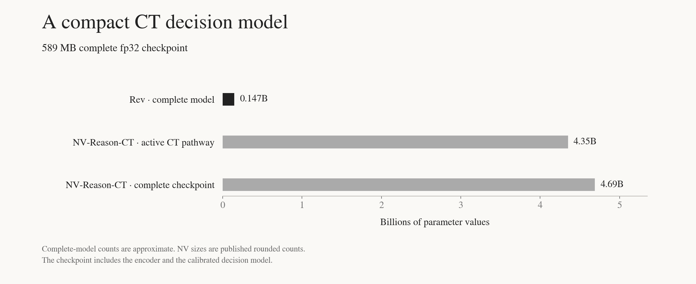

<p align="center">
  <a href="https://github.com/hcltech-robotics/rev-ct">Code and documentation</a><br>
  <a href="https://huggingface.co/spaces/chrisvoncsefalvay/rev-ct-demo">Interactive demo</a><br>
  <a href="https://github.com/hcltech-robotics/rev-ct/releases/tag/v0.3.2">Release v0.3.2</a><br>
  <a href="https://github.com/hcltech-robotics/rev-ct/blob/v0.3.2/reports/benchmark.md">Benchmark protocols and measurements</a>
</p>

# RevCT

A typed decision model for computed tomography (CT).

Rev CT classifies the 18 CT-RATE chest findings in a single image-encoder pass,
returning calibrated scores, present/absent decisions and schema-defined records.
It achieves **state-of-the-art macro-F1 within NVIDIA's published CT-RATE
18-class comparison**: **0.6154 macro-F1** and **0.8715 macro-AUROC** on the
corrected 3,002-volume validation cohort.

The complete model is compact: approximately **147M parameters** in a
**589 MB** checkpoint, including the frozen COLIPRI image encoder. It has no
language decoder. With the tested fast processor, warm volume inference averages
**2.856 seconds** on an A100 80 GB, **7.63× faster** than the measured
NV-Reason-CT 18-question protocol.

Weights and loading metadata are hosted on Hugging Face. The inference package
and documentation are on GitHub.

## Installation

Volume inference requires Python 3.11+ and PyTorch. Install the inference package:

```bash
gh repo clone hcltech-robotics/rev-ct
cd rev-ct
git checkout v0.3.2
python -m pip install '.[inference]'
hf auth login
```

The supported inference stack uses Transformers 5.6.2, COLIPRI 0.1.3 and
dynamic-network-architectures 0.4.3. The image encoder weights are bundled in
Rev's checkpoint. COLIPRI supplies the installed architecture and reference
processor; a second encoder-weight download is unnecessary.

## Quick start

```python
import rev_ct  # registers the installed decision-model architecture
import torch
from transformers import AutoModel, AutoProcessor

repo = "hcltech-robotics/rev-ct"
torch.backends.cuda.matmul.allow_tf32 = False
torch.backends.cudnn.allow_tf32 = False
model = AutoModel.from_pretrained(repo).eval().to("cuda")
processor = AutoProcessor.from_pretrained(repo, preprocessing="fast")
inputs = processor(images3d=["chest.nii.gz"], return_tensors="pt")

with torch.inference_mode():
    output = model(**inputs, volume_names=["chest.nii.gz"])

print(output.records[0])
print(output.probabilities)  # calibrated scores, (1, 18)
print(output.decisions)      # trained present/absent rule, (1, 18)
```

Importing `rev_ct` registers `AutoConfig`, `AutoModel` and `AutoProcessor` for
`model_type="decision-model"`. No `trust_remote_code` flag is required.
Keep the model in fp32 and preserve the head tensor dtypes. Global `.half()` or
`.bfloat16()` conversions alter the calibrated decision path and are unsupported.
Pin the same Hub `revision` for both objects in deployed applications.

Reference preprocessing remains the processor default. The explicit `fast`
option uses the tested SimpleITK path and falls back to the reference processor
for unsupported geometry. `save_pretrained()` stores weights and metadata,
reloadable with the installed package, including offline with `local_files_only=True`.

## Licence/terms of use

Rev code and learned heads use **Apache-2.0**. The bundled Microsoft COLIPRI
image encoder retains its **MIT** licence and notice in `COLIPRI_LICENSE`.
CT-RATE is gated and has separate **CC BY-NC-SA 4.0** dataset terms. This release
does not redistribute CT volumes. See `LICENSE`, `NOTICE` and upstream terms.

### Use case

Chest-CT classification research, reproducible evaluation and applications
requiring a fixed vocabulary of typed finding decisions. The model has not
been clinically validated. It cannot establish a complete normal examination
or generate a radiology report.

## Model architecture

**Architecture type:** Decision model, frozen 3D transformer encoder with calibrated linear heads.<br>
**Network architecture:** COLIPRI-CRM pooled, projected 768-dimensional image features; training standardisation; 18 class-balanced logistic regressions; training-only F1 decision biases; per-label isotonic score calibration.<br>
**Task:** Multi-label chest-CT classification with typed outputs.<br>
**Base model:** `microsoft/colipri`, image encoder only.<br>
**Model type:** `decision-model`.<br>
**Model size:** Approximately 147M parameters for the complete model.<br>
**Checkpoint:** One complete `model.safetensors`, 588,703,212 bytes.

The unused COLIPRI text encoder is omitted. The bundled encoder tensors match
the pinned upstream image checkpoint exactly. Decisions threshold the
bias-adjusted logits at zero, equivalent to a fixed 0.5 sigmoid threshold.
Calibrated scores are reported separately and need not cross 0.5 at the
decision boundary.



## Input

**Input type:** Image.<br>
**Input format:** 3D NIfTI (`.nii` or `.nii.gz`) with intensities in Hounsfield units and valid physical spacing/orientation.<br>
**Preprocessing:** RAS reorientation, 2 mm isotropic resampling, HU clamp to [-1000, 1000], scaling to [-1, 1], centred 192³ crop/pad.<br>
**Alternative input:** Pooled, projected, unnormalised 768-dimensional features from the pinned COLIPRI encoder, rounded through fp16 as in training storage.

The reference processor uses TorchIO and centre cropping. It does not perform
an anatomical lung crop. Convert DICOM series to a correctly oriented HU NIfTI
before inference. For CT-RATE reproduction, use `dataset/valid_fixed/` rather
than the uncorrected validation volumes.

## Output

**Output type:** Typed multi-label decisions.<br>
**Output format:** PyTorch tensors and strict JSON-compatible `rev-1.0` records.<br>
**Output fields:** Per-finding `decision`, calibrated `score`, decision `confidence`; three highest-scoring positive findings; mean-score burden and positive finding count.

`RevOutput` includes `logits`, `raw_probabilities`, `probabilities`, `decisions`
and `records`. Confidence is the calibrated score for a present decision and
one minus that score for an absent decision. The score can disagree with the
separately trained decision threshold. The burden summary is a mean score,
not a validated clinical severity measure. The package also provides a
[Clef-shaped typed request interface](https://github.com/hcltech-robotics/rev-ct/blob/v0.3.2/docs/inference.md#typed-requests)
for questions about the trained finding vocabulary.

### Finding vocabulary

Medical material; Arterial wall calcification; Cardiomegaly; Pericardial effusion;
Coronary artery wall calcification; Hiatal hernia; Lymphadenopathy; Emphysema;
Atelectasis; Lung nodule; Lung opacity; Pulmonary fibrotic sequela; Pleural
effusion; Mosaic attenuation pattern; Peribronchial thickening; Consolidation;
Bronchiectasis; Interlobular septal thickening.

## Software integration

**Runtime engines:** PyTorch and Transformers, with NumPy/SciPy for the reference calibrated heads.<br>
**Operating system tested:** Linux.<br>
**GPU tested:** NVIDIA A100-SXM4-80GB (Ampere).<br>
**CPU support:** Head inference and full checkpoint loading are verified. CPU volume inference is supported but its speed is not reported here.

Code, CLI, dependency specification, tests, complete inference documentation
and benchmark scripts are in the [GitHub release](https://github.com/hcltech-robotics/rev-ct/releases/tag/v0.3.2).
Standard inference reads safetensors and JSON only. It does not load pickle,
joblib or scikit-learn objects.

## Model version

**0.3.2.** Complete safetensors checkpoint with installed Transformers
`decision-model` inference.

## Training and evaluation datasets

### Training dataset

**Data modality:** Chest CT and report-derived labels.<br>
**Dataset:** CT-RATE training split, with the reported final head-training frame of 46,144 chest volumes.<br>
**Labelling:** Official RadBERT labels overwritten where clean gpt-oss-120b report labels are available. Parsing failures retain the official labels.<br>
**Encoder pretraining:** CT-RATE training scans and NLST; the encoder is frozen for Rev head training.

The heads use `LogisticRegression(C=1.0, class_weight="balanced", max_iter=2000)`.
Five shuffled training folds with `random_state=0` supply out-of-fold
probabilities for decision bias selection and isotonic calibration. The final
heads are refitted on the training frame. Biases and calibration use training
OOF probabilities only. Validation targets retain the official RadBERT labels.

### Evaluation dataset

**Dataset:** Official CT-RATE validation, 3,039 volumes.<br>
**Corrected cohort:** 3,002 volumes after the 37 official no-chest exclusions, matching NV-Reason-CT's reported cohort.<br>
**Targets:** Official RadBERT validation labels for all 18 findings.<br>
**Metric protocol:** Unweighted macro positive-class F1 at the fixed trained decision threshold; macro AUROC on raw sigmoid probabilities.

## Benchmarks

| Model | Type | Macro-F1 | Macro-AUROC |
|---|---|---:|---:|
| **RevCT** | 3D encoder conditioning calibrated decision heads | **0.6154** | **0.8715** |
| NV-Reason-CT | Native 3D generative VLM | 0.614 | 0.871 |
| VoxelFM | 3D image-only pretraining | 0.581 | 0.870 |
| Pillar-0 | 3D contrastive | 0.544 | 0.861 |
| ClinFusion-8B | Fused 2D/3D generative MLLM | 0.442 | n/r |
| CT-CLIP | 3D contrastive | 0.398 | 0.733 |
| Merlin | 3D contrastive | 0.358 | 0.662 |
| MedGemma 1.5 | Up to 85 axial slices | 0.303 | n/r |

*CT-RATE classification, 18 labels. n/r = not reported. Rev uses supervised
CT-RATE heads and training-OOF decision biases. NVIDIA reports direct Yes/No
prompts without a classification head or task-specific adaptation.*


### Rev validation results

| Cohort | Volumes | Macro-F1 | Macro-AUROC |
|---|---:|---:|---:|
| Corrected validation | 3,002 | 0.615418 | 0.871526 |
| Full validation | 3,039 | 0.611306 | 0.865506 |

Accuracy is evaluated on cached validation embeddings. All 54,702 decisions
match the source model, with maximum calibrated-score error 5.96e-8. Volume
inference is checked on 64 scans: all 1,152 decisions match cached decisions.
GPU save/reload preserves all 144 scores and decisions in an eight-scan check.

## Inference speed

**Test hardware:** Hugging Face Jobs, A100-SXM4 80 GB, 12 allocated vCPU.<br>
**Sample:** 64 distinct CT-RATE patients, 16 each of four acquisition strata.<br>
**Timing scope:** Warm local NIfTI to CPU-visible output, including preprocessing and postprocessing, excluding downloads and model loading.<br>
**Protocol:** Batch one, one timed pass per scan/protocol, synchronised CUDA, one Torch/SimpleITK CPU thread, TF32 disabled.

| Model / inference path | Output | Mean s/scan | Median s/scan | p95 s/scan | Serial scans/s |
|---|---|---:|---:|---:|---:|
| **Rev, fast preprocessing, fp32** | **18 typed decisions** | **2.856** | **2.667** | **4.201** | **0.350** |
| Rev, reference preprocessing, fp32 | 18 typed decisions | 7.779 | 6.953 | 13.811 | 0.129 |
| NV-Reason-CT, 18 Yes/No prompts, bf16 | 18 binary answers | 21.796 | 21.292 | 25.744 | 0.0459 |
| COLIPRI zero-shot, paired prompts, bf16 | 18 similarity scores | 6.962 | 6.186 | 13.281 | 0.144 |
| NV-Reason-CT, one list prompt, bf16 | Free text | 7.359 | 6.365 | 11.858 | 0.136 |
| Pillar-0 ChestCT, fp32 | Vision features | 2.521 | 2.381 | 3.626 | 0.397 |
| Pillar-0 ChestCT, AMP bf16 | Vision features | 2.064 | 1.922 | 3.185 | 0.484 |

The same 64 scans are used throughout. NV uses verified fast kernels,
thinking disabled and greedy decoding. The measured prompts are speed
protocols, not a reproduction of NVIDIA's reported classification accuracy.
The list protocol returned zero valid requested 18-key Boolean JSON mappings
out of 64 responses. Pillar has no fitted CT-RATE head in this timing study.
Its feature timings and NV's free-text timings cover different output tasks.


Fast preprocessing reduces mean CPU preprocessing from **6.884 to 1.961 s**
(**3.51×**) and total serial latency by **2.72×**, with pixel-identical inputs
on all 64 scans. Four preprocessing workers reach **0.701 scans/s per GPU**,
including pool startup for each 16-scan stream, with identical scores and
decisions. These figures are not the combined throughput of four GPUs.
The acquisition-balanced sample oversamples uncommon protocols and is not an
estimate of a hospital's case distribution.

## Limitations

The labels are report-extracted weak supervision. The 18 findings do not
cover all pathology. Training out-of-fold splits are at volume level;
related reconstructions may cross folds. A baseline subgroup audit identified
reduced performance on small-FOV acquisitions; the final model has not been
separately evaluated in those subgroups.

Site-specific prevalence, coverage and acquisition changes require separate
evaluation of decisions and score calibration. The model is for research and
has not been clinically validated.

## References and provenance

- [COLIPRI](https://huggingface.co/microsoft/colipri), image checkpoint `892e42ec363f6c561b89c459d60fcd95ac1a99bf`.
- [CT-RATE](https://huggingface.co/datasets/ibrahimhamamci/CT-RATE), revision `deeca4d89e9f978d4d1bccd88a55071ddbb146bb`.
- [NV-Reason-CT](https://huggingface.co/nvidia/NV-Reason-CT), comparison revision `386b93e034983f6c1fc841a43833a1b6a0cd9c13`.
- [Pillar-0 ChestCT](https://huggingface.co/YalaLab/Pillar0-ChestCT), revision `b9dfd833a947744382d4f1bd73b5dd72fcb58b34`.
- [Pillar preprocessing](https://github.com/YalaLab/rave), with the [chest fine-tuning recipe](https://github.com/YalaLab/pillar-finetune).
- [Accuracy reproduction](https://github.com/hcltech-robotics/rev-ct/blob/v0.3.2/reports/conversion_validation.json) and [timing data](https://github.com/hcltech-robotics/rev-ct/blob/v0.3.2/reports/benchmark_64.json).

## Citation

Rev was developed at the HCLTech Robotics Intelligence CoE. If you use RevCT
in your work, cite the software release and report the version and checkpoint
revision used.

von Csefalvay, C., & Foldi, T. (2026). *RevCT: A typed decision model for computed
tomography (CT).* (Version 0.3.2) [Software]. HCLTech Robotics Intelligence CoE.
https://doi.org/10.57967/hf/10861

```bibtex
@software{voncsefalvay2026revct,
  author  = {von Csefalvay, Chris and Foldi, Tamas},
  title   = {RevCT: A typed decision model for computed tomography (CT)},
  year    = {2026},
  version = {0.3.2},
  doi     = {10.57967/hf/10861},
  url     = {https://github.com/hcltech-robotics/rev-ct}
}
```
